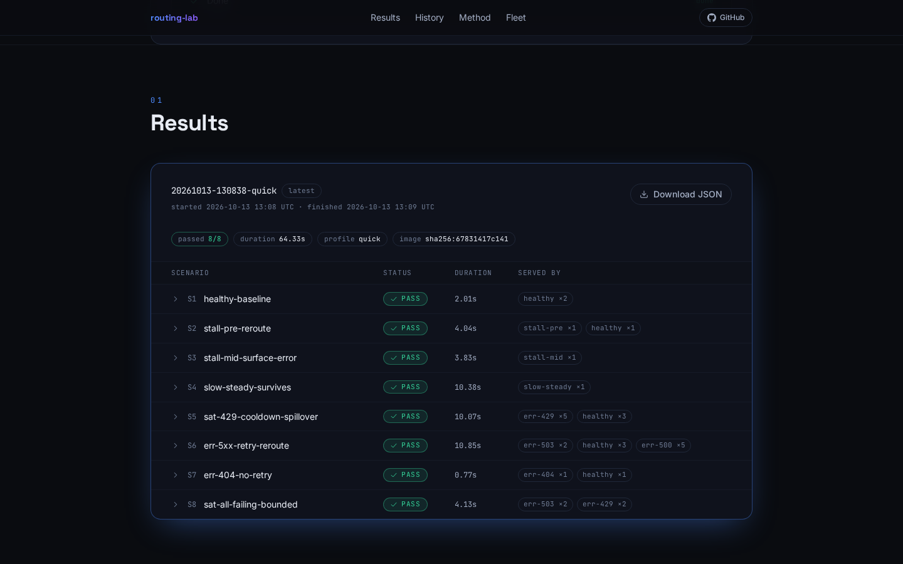
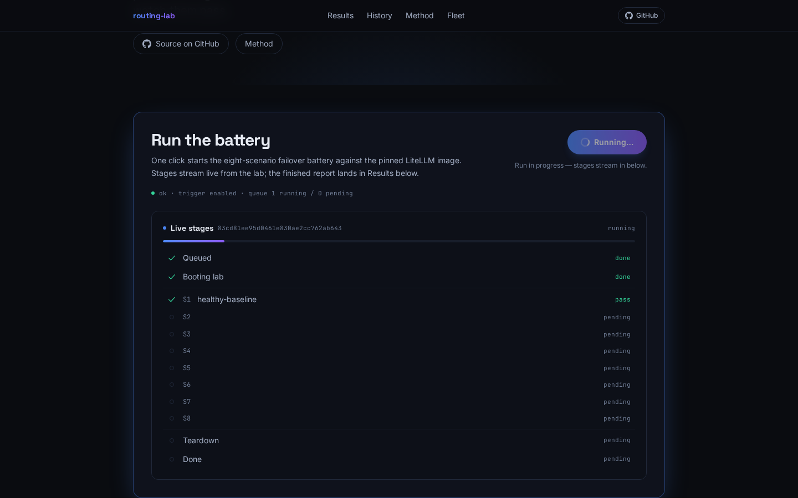
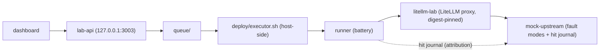

# routing-lab

routing-lab is a fault-injection testbench that proves LiteLLM router failover semantics, with hard evidence.

[](https://github.com/sjhnandez/routing-lab/actions/workflows/ci.yml)
[](LICENSE)

Per battery run, three short-lived containers share one internal Docker network (no host ports): a scenario **runner** drives a digest-pinned **LiteLLM** proxy whose model groups point at a deterministic **mock upstream** with injectable fault modes (stalls, slow streams, 404/429/500/503, full saturation). Every scenario has a single claim under test and hard assertions evaluated from the client outcome plus the mock's hit journal. The battery exits non-zero if any assertion fails and writes a JSON report with the raw evidence.

The same stack backs an interactive dashboard: click **Run experiment** and the battery executes on the host, streaming every stage back over SSE.

## What it proves

One bullet per verified finding; quoted fragments are from real runs (full catalog in `docs/scenarios.md`).

- **Pre-content stalls reroute cleanly.** A provider that accepts the stream and never sends a first chunk is killed by the stream silence limit and rerouted: the journal shows `stall-pre` `aborted` with `chunks_sent: 0`, then a `healthy` `completed` hit, and the client sees a clean completion (S2).
- **Mid-content stalls cannot be un-sent.** After 3 chunks reached the client the turn can no longer reroute: the failure surfaces as an in-band SSE error (`APIConnectionError: Timeout on reading data from socket`), the stream ends without `[DONE]`, and the journal shows no healthy fallback hit (S3).
- **`stream_timeout` is a silence-gap limit, not a total-duration cap.** A 12-chunk stream lasting about 9.6 s with 800 ms gaps completes under a 3 s silence limit, untouched (S4).
- **Retry-class 5xx are retried against pool siblings, then rerouted.** Streamed 503 and 500 both journal 2+ hits on the failing mode (the retry reaches the sibling) before the fallback completes the client turn; the captured response headers show `x-litellm-attempted-fallbacks: 1` on the fallback-served success (S6).
- **429 cools the pool, traffic spills over, and the pool re-enters after expiry.** The first 429 cools the pool (the retry reaches the sibling before both members cool down); the next request touches the cooling pool 0 times and is served by the fallback; after cooldown expiry the journal shows re-entry (S5).
- **404 is never retried.** Exactly one upstream hit, even with a healthy sibling available, then the fallback reroutes (S7).
- **Saturation fails in bounded time.** When every member of a group and its backup chain are failing, the client receives an error in bounded time (about 4 s in the quick profile, asserted under 60 s), with pool retries attempted and no healthy deployments touched (S8).

## The dashboard



*After a fresh run: 8/8 green, per-scenario assertions and the raw JSON report one click away.*



*Mid-run: the stages panel streaming scenario results over SSE while the battery executes on the host.*

Both screenshots are captured by the browser E2E (`tests/e2e/dashboard_e2e.py`) on a real run against the full local stack. There is no hosted demo: the dashboard is served by `lab-api` on `127.0.0.1:3003`, and battery runs execute where Docker is available. A public deployment (tunnel plus always-on executor) is future work, not part of this repository yet.

## Architecture



Per run, `runner` sends OpenAI-compatible requests through `litellm-lab`, which forwards `openai/<mode>` calls to `mock-upstream`; the runner then reads the mock's hit journal over a side channel to attribute exactly what happened. In the interactive layer, the dashboard talks to `lab-api`, which drops a run request into `queue/`; the host-side executor picks it up, runs the battery with Docker Compose, and streams staged events back over SSE.

## Quick start

All commands run from the repository root. Prerequisite: Docker with the Compose plugin.

### A. Battery only

```sh
LAB_PROFILE=quick docker compose --env-file deploy/pinned-versions.env -f deploy/docker-compose.dev.yml up -d --build
LAB_PROFILE=quick docker compose --env-file deploy/pinned-versions.env -f deploy/docker-compose.dev.yml --profile run build runner
LAB_PROFILE=quick docker compose --env-file deploy/pinned-versions.env -f deploy/docker-compose.dev.yml --profile run run --rm runner
LAB_PROFILE=quick docker compose --env-file deploy/pinned-versions.env -f deploy/docker-compose.dev.yml down
```

The runner exits 0 iff all 8 scenarios pass and writes `reports/<run_id>.json`. The quick profile takes about 1 minute; `LAB_PROFILE=full` swaps in the production timings verbatim and takes about 6 minutes by design (the cooldown-expiry waits are about 122 s each). Optionally `export LAB_GIT_REV=$(git rev-parse --short HEAD)` first to record the revision in the report.

### B. Interactive dashboard

```sh
# 1) build the SPA (dashboard/dist is not committed)
docker run --rm --user $(id -u):$(id -g) -v "$PWD/dashboard:/w" -v "$PWD/.npmcache:/cache" -w /w -e npm_config_cache=/cache node:22-bookworm-slim sh -c "npm ci && npm run build"

# 2) dashboard backend + API on http://127.0.0.1:3003
LAB_PROFILE=quick docker compose --env-file deploy/pinned-versions.env -f deploy/docker-compose.dev.yml --profile api up -d --build lab-api

# 3) host-side executor: turns "Run experiment" clicks into real battery runs
./deploy/executor.sh
```

Open `http://127.0.0.1:3003` and click **Run experiment**. Runs are gated (one at a time, 120 s cooldown, per-IP rate limit). Use `./deploy/executor.sh --once` for a single pass instead of the polling loop, and `... --profile api down` when done.

### C. Tests

```sh
docker run --rm -v "$PWD:/w" -w /w python:3.12-slim sh -c "pip install -q -r tests/requirements.txt && python -m pytest tests/ -q -p no:cacheprovider"
```

CI (`.github/workflows/ci.yml`) runs the same suite plus a compose config validation on every push and pull request. The browser end-to-end test, which drives one real dashboard run and refreshes the screenshots above, is `tests/e2e/dashboard_e2e.py`; its docstring is the runbook.

## Evidence model

LiteLLM's stdout never names which deployment served, stalled, or failed a turn, and proxy logs are not stable evidence. This lab attributes behavior from the **mock upstream's hit journal**: every upstream call is recorded with its fault mode, stream flag, HTTP status, chunks sent, outcome (`completed` / `errored` / `aborted`), and timestamps, and the journal is reset at the start of every scenario. "Retried against the sibling" means the journal shows 2+ hits on the same failing mode inside one client turn; it is never inferred from logs.

Every scenario result embeds the raw journal entries, per-request hit windows, and a timeline. A complete green report is `docs/example-report.json`; the report schema is described in `docs/methodology.md`, and `docs/scenarios.md` lists each scenario's claim under test and its hard assertions. Quoted numbers in this README come from quick-profile runs; the full profile runs the production timings verbatim.

## Repository layout

| Directory | What it is |
| --- | --- |
| `mock_upstream/` | Deterministic OpenAI-compatible fake provider. The requested model selects a fault mode (`healthy`, `stall-pre`, `stall-mid`, `slow-steady`, `err-429`, `err-503`, `err-500`, `err-404`); every call is journaled with status, chunks sent, and outcome. |
| `lab_config/` | The config under test: the frozen production `router_settings` contract plus lab model groups and fallback chains, in `quick` and `full` profiles. |
| `runner/` | The eight-scenario battery: resets the journal, drives the proxy, evaluates hard assertions, writes JSON reports. |
| `deploy/` | Dev Compose stack, digest-pinned LiteLLM image, and the host-side executor for interactive runs. |
| `api/` | `lab-api`: run trigger with gates, queue, SSE event replay, and the reports/history/docs API behind the dashboard. |
| `dashboard/` | React/Vite SPA: Run button, live SSE stages, results, history, fleet, and method sections. |
| `prober/` | Standalone probe toolkit for a real router deployment; its JSONL history feeds the dashboard's Fleet tab. |
| `tests/` | Unit tests for the lab components plus the containerized browser E2E. |
| `docs/` | Methodology (including the report schema), scenario catalog, example report, E2E screenshots. |

Generated at run time (not committed): `reports/` (JSON evidence reports) and `queue/` (interactive run requests and SSE event streams).

## Findings

Four results are worth expanding on; each is backed by the journal and client evidence quoted above.

1. **503 retryability is topology-dependent.** In a 2-deployment pool the first 503 cools one member but leaves a healthy sibling, so the retry is allowed and reaches the sibling (2 journal hits), then the fallback reroutes. In a singleton group the same failure cools the only member, the health check declines the retry, and the 503 reroutes after exactly 1 hit. The commonly assumed "503 fast-fail" is a no-healthy-sibling phenomenon, not a property of the 503 class. The frozen contract has no `ServiceUnavailableError` retry-policy key, so 503 takes the generic retry path plus the health check.
2. **404 is never retried, in any topology.** In the pinned image the retry decision raises for `NotFoundError` before any health or policy logic runs; exactly one upstream hit, even with an idle sibling available.
3. **Pre-/post-content failover asymmetry.** Before any chunk has reached the client, a stalled stream can be aborted and rerouted invisibly (S2). Once a single chunk is sent, rerouting would double-send, so the failure surfaces to the client (S3). Failover behavior therefore depends on where in the stream the provider fails, not only on the failure class.
4. **Silence gap, not total duration.** `timeout` / `stream_timeout` kill silence: a ~9.6 s stream with 800 ms gaps completes under a 3 s silence limit, and the limit fires only when a gap itself exceeds it (S4).

## License

MIT. See `LICENSE`.
