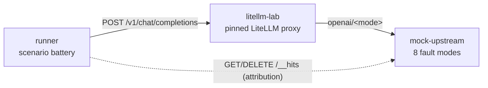
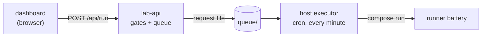

# Methodology

routing-lab is a deterministic fault-injection testbench for a LiteLLM router
configuration. It answers one question with hard evidence: when an upstream
provider stalls, rate-limits, errors or goes entirely unavailable, what does
the router do to the client turn - retry, reroute, surface the error, or keep
a healthy stream alive?

## Architecture

Three short-lived containers on one internal Docker network (no host ports).

Battery data path - one scenario turn, driven by the runner:

Interactive pipeline - a dashboard click to a finished report:

- `mock_upstream/` - OpenAI-compatible fake provider. The requested model
  string selects a fault mode (`healthy`, `stall-pre`, `stall-mid`,
  `slow-steady`, `err-429`, `err-503`, `err-500`, `err-404`). Every chat
  completion is journaled (`GET /__hits`) with mode, stream flag, status,
  chunks sent, outcome (`completed` / `errored` / `aborted`) and timestamps.
- `lab_config/router.<profile>.yaml` - the config under test: the frozen
  production `router_settings` contract plus a lab `model_list` whose groups
  point at the mock, plus lab fallback chains.
- `runner/` - the scenario battery. Per scenario it resets the journal, drives
  the proxy, fetches the journal, and evaluates hard assertions. It exits
  non-zero unless all 8 scenarios pass and writes a JSON report.

## The mock journal is the attribution source

LiteLLM's stdout never names which deployment served, stalled or failed a turn,
and proxy logs are not stable evidence. The mock journal is: it records exactly
which fault mode an upstream call reached, when, and how it ended. "Retried
against the sibling" means "the journal shows >= 2 hits on the same error mode
within one client turn" - not "the logs looked right".

The journal is reset (`DELETE /__hits`) at the start of every scenario, so each
scenario has an isolated evidence window. After the client steps the runner
waits a short settle (0.5-0.75s) so asynchronously flushed cancellation entries
(e.g. `aborted` after a silence kill) are in the journal before it is read.

## Silence-gap semantics (timeout / stream_timeout)

`timeout` and `stream_timeout` are SILENCE limits, not total-duration caps:

- Non-stream: no response headers within `timeout` -> the call is killed and
  can be retried/rerouted.
- Stream: no chunk within `stream_timeout` -> the stream is killed.
  - If no content chunk was sent yet, LiteLLM reroutes to a fallback; the
    client sees a clean success (S2).
  - Once any content chunk reached the client, the turn cannot be un-sent: the
    failure surfaces as an error (S3).
- A steady stream whose gaps stay under `stream_timeout` is never killed, no
  matter how long the total turn runs (S4: ~9.6s turn under a 3s silence
  limit).

## Retry, cooldown and why the pools exist

The frozen contract runs `allowed_fails: 0` (cool a deployment on its first
failure, for `cooldown_time`) with a small per-class `retry_policy`. In the
pinned image (`litellm/router.py`, `litellm/utils.py`) the retry decision is:

1. A matching `retry_policy.<Class>Retries` value takes precedence over the
   health check (`router.py:7719-7749`); the policy is resolved by walking the
   exception's MRO (`router_utils/get_retry_from_policy.py`), falling back to
   `DefaultRetries`.
2. Otherwise `should_retry_this_error()` decides (`router.py:7897`):
   - `NotFoundError` (404) raises immediately - never retried (`router.py:7935`).
   - status codes outside 408/409/429/5xx raise immediately
     (`litellm/utils.py:7155`).
   - no healthy deployments left (`_num_healthy_deployments <= 0`) ->
     decline the retry (`router.py:7956`).
   - otherwise: allowed.
3. Backoff: while the group still has a healthy deployment, LiteLLM retries
   immediately with no sleep (`router.py:8011`); otherwise it backs off.

Consequence for single-deployment groups: `allowed_fails: 0` cools the only
deployment on its first failure, so by the time `should_retry_this_error()` runs
there is never a healthy deployment left; the retry is declined and the failure
reroutes via the fallback chain after exactly ONE upstream hit. This is why the
lab's retry-exercised groups are 2-deployment pools (see `lab_config/README.md`):
with a healthy sibling present the retry is permitted and re-dispatched
immediately, so the journal observes the second hit before the fallback reroute.
Production model groups are pools too, so the pool shape is also more faithful
than the pre-pool single-deployment lab.

Class findings (pinned image, frozen contract, pooled groups):

- err-500 / err-429: retried against the sibling via `retry_policy`
  (`InternalServerErrorRetries` / `RateLimitErrorRetries`); the journal shows
  >= 2 hits, then the fallback reroutes to `healthy-pool`.
- err-503: `retry_policy` has no `ServiceUnavailableErrorRetries` key and the
  class maps to nothing else, so the generic path applies: 503 is
  status-retryable and IS retried while a healthy sibling remains (journal:
  2 hits). In a singleton group the same mechanism declines the retry ("no
  healthy deployments left") and the 503 reroutes after 1 hit.
- err-404: `NotFoundError` raises inside `should_retry_this_error()` before any
  health check - exactly 1 upstream hit even with a healthy sibling available.

Policy-driven retries that fire after the whole pool is cooling add latency but
cannot reach the upstream (no deployment is selected), which is why S8's
exhaustion stays bounded while still showing pool retries.

## Response headers as supplementary evidence

The runner captures litellm's response headers where present:
`x-litellm-attempted-retries` and `x-litellm-attempted-fallbacks`
(`router_utils/add_retry_fallback_headers.py`). The header describes the router
call that produced the final response: a fallback-served success carries
`attempted_retries=0, attempted_fallbacks=1` - the retries that happened inside
the failed group are recorded by the journal, not the header. The header is
supplementary evidence; assertions never depend on it.

## quick vs full profiles

`router.full.yaml` carries the production contract values verbatim (plus the
lab fallback extensions); `router.quick.yaml` scales only timings for
demo-speed runs:

| Setting | full | quick |
| --- | --- | --- |
| `num_retries` | 5 | 2 |
| `cooldown_time` | 120 s | 8 s |
| `timeout` | 20 s | 3 s |
| `stream_timeout` | 20 s | 3 s |
| `retry_policy.RateLimitErrorRetries` | 5 | 2 |
| `retry_policy.InternalServerErrorRetries` | 5 | 2 |
| `retry_policy.TimeoutErrorRetries` | 3 | 2 |

Everything else (routing strategy, `allowed_fails`, `allowed_fails_policy`,
`retry_after`, the whole `model_list`, all fallback chains) is identical in
both profiles. The cooldown-expiry waits (S5 and S6) are derived from the
active profile's `cooldown_time` (+ a 1.5s margin), so the same scenario code
works for both profiles; full-profile batteries are slow by design (~6 min -
the two waits are ~122s each).

## Frozen inputs and integrity rules

- `lab_config/litellm.config.yaml` is the frozen production contract. The
  `router_settings` block in both router profiles must stay byte-identical to
  it (excluding the documented lab fallback extension); only `model_list`
  entries and prose may change.
- `mock_upstream/` is frozen during scenario calibration: the fault timings and
  the journal are the measuring instrument and must not be tuned to make tests
  pass.
- Assertions test the claims under test, not tautologies. Every hard assertion
  maps to an externally observable fact (client outcome, journal counts,
  durations). Bounds are calibrated from real runs of the pinned stack; if a
  claim cannot be shown, the scenario fails and the report carries the raw
  evidence - assertions are never weakened to force a green run.
- The report JSON schema is stable (the dashboard consumes it); scenario
  results embed the raw journal entries, per-request hit windows and timeline.

## Running the battery

    # provenance: record the repo revision in the battery report
    export LAB_GIT_REV=$(git rev-parse --short HEAD)

    # quick profile (default):
    LAB_PROFILE=quick docker compose --env-file deploy/pinned-versions.env \
      -f deploy/docker-compose.dev.yml up -d --build
    LAB_PROFILE=quick docker compose --env-file deploy/pinned-versions.env \
      -f deploy/docker-compose.dev.yml --profile run run --rm runner
    LAB_PROFILE=quick docker compose --env-file deploy/pinned-versions.env \
      -f deploy/docker-compose.dev.yml down

The litellm image is pinned by manifest digest in
`deploy/pinned-versions.env` (pullable digest; the image tag floats and is
never used directly). The runner exits 0 iff all 8 scenarios pass; reports land
in `reports/<run_id>.json`, and `docs/example-report.json` holds a full green
run. `LAB_GIT_REV` (a short revision string, e.g. from `git rev-parse --short
HEAD`) is recorded as `lab.git_rev` in the report.

## Report schema (abridged)

    run_id, profile, started_at, finished_at, duration_s
    lab: { base_url, mock_url, litellm_image, git_rev }
    config_snapshot: { source, router_settings }
    scenarios: [ { id, name, status, duration_s, expected, observed,
                   assertions: [{desc, pass, detail}],
                   timeline: [{t, event, detail}],
                   served_by: [{mode, hits}],
                   mocked_hits: [ raw journal entries ] } ]
    summary: { total, passed, failed, status }
